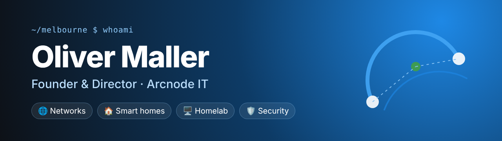

<picture>
  <source media="(prefers-color-scheme: dark)" srcset="assets/banner-dark.png">
  <source media="(prefers-color-scheme: light)" srcset="assets/banner-light.png">
  
</picture>

  

  
  
  

---

## 👋 About me

I run **[Arcnode IT](https://arcnode.com.au)** in Melbourne, designing and installing the tech that makes homes and small businesses work: networks, security, access control and smart-home automation. Out of hours I'm usually in my homelab, tinkering with something new or building integrations for gear that doesn't have one yet.

<table>
  <tr>
    <td width="33%" valign="top">
      <h3>🌐 Networks</h3>
      UniFi networks, Wi-Fi, cameras and access control, designed properly and documented.
    </td>
    <td width="33%" valign="top">
      <h3>🏠 Smart homes</h3>
      Home Assistant and Apple Home that the whole family can use: alarms, locks, climate and automations.
    </td>
    <td width="33%" valign="top">
      <h3>🖥️ Homelab</h3>
      Proxmox, Docker and Kubernetes. Self-hosting everything I can, and breaking it so clients don't have to.
    </td>
  </tr>
</table>

## 🚀 Featured project

<table>
  <tr>
    <td width="96" valign="top">
      
    </td>
    <td valign="top">
      <a href="https://github.com/olliemaller/ha-protege-wx"><b>ha-protege-wx</b></a>: a Home Assistant integration for <b>ICT Protege WX</b> alarm and access controllers.
      Arm, disarm, unlock doors and see who did what, about every second, through the controller's own web interface. No Automation licence needed. HomeKit-ready.
        
      
      
      
    </td>
  </tr>
</table>

**Also tinkering with:** [homebridge-daikin-airbase](https://github.com/olliemaller/homebridge-daikin-airbase) (Daikin Airbase in HomeKit) · [ProxmoxVE](https://github.com/olliemaller/ProxmoxVE) (community helper scripts)

## 🧰 Toolbox

**Platforms I live in**

  
  
  
  
  
  

**Homelab & infrastructure**

  

**Code & everyday**

  

## 📊 Stats

  
  

  

  <picture>
    <source media="(prefers-color-scheme: dark)" srcset="https://raw.githubusercontent.com/olliemaller/olliemaller/output/snake-dark.svg">
    <source media="(prefers-color-scheme: light)" srcset="https://raw.githubusercontent.com/olliemaller/olliemaller/output/snake-light.svg">
    
  </picture>

## 😄 Just for fun

  

  

---

  <b>Got a project, a network that misbehaves or a gadget that needs integrating?</b> 
  <a href="https://arcnode.com.au">Get in touch through Arcnode IT</a>, or open an issue on any of my repos.

