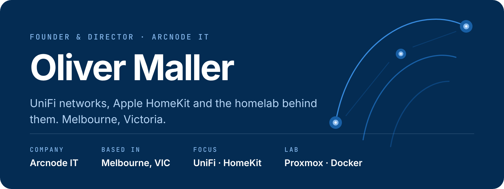
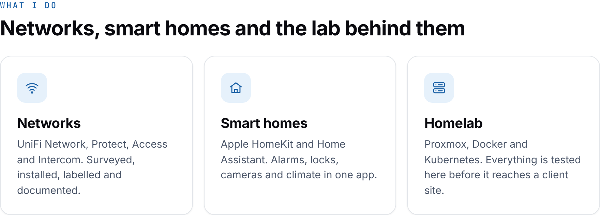
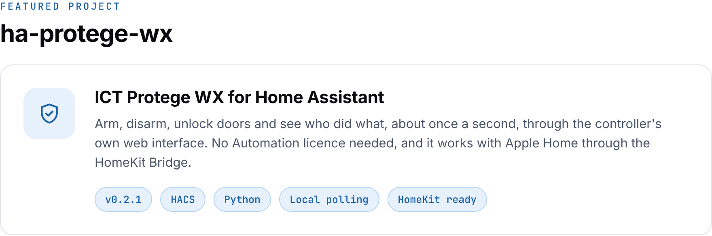
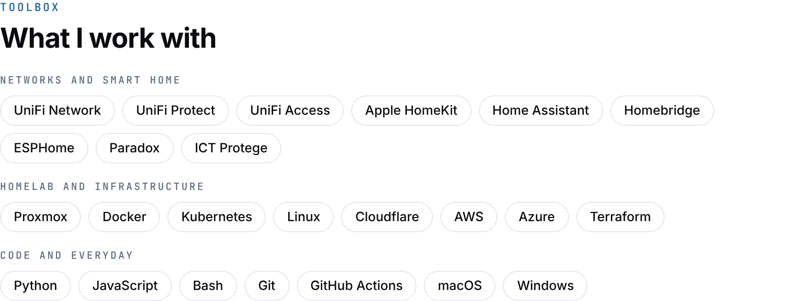
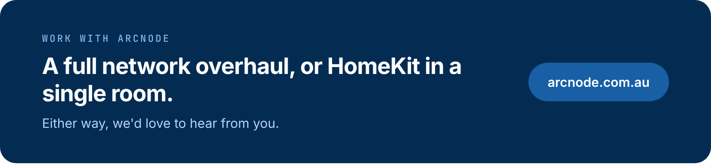

 

<picture>
  <source media="(prefers-color-scheme: dark)" srcset="assets/services-dark.png">
  
</picture>

  

<a href="https://github.com/olliemaller/ha-protege-wx">
  <picture>
    <source media="(prefers-color-scheme: dark)" srcset="assets/project-dark.png">
    
  </picture>
</a>

  <a href="https://github.com/olliemaller/ha-protege-wx"><b>View the repository</b></a> ·
  <a href="https://my.home-assistant.io/redirect/hacs_repository/?owner=olliemaller&repository=ha-protege-wx&category=integration">Open in HACS</a> ·
  Also: <a href="https://github.com/olliemaller/homebridge-daikin-airbase">homebridge-daikin-airbase</a>, <a href="https://github.com/olliemaller/ProxmoxVE">ProxmoxVE</a>

 

<picture>
  <source media="(prefers-color-scheme: dark)" srcset="assets/toolbox-dark.png">
  
</picture>

## Activity

<picture>
  <source media="(prefers-color-scheme: dark)" srcset="https://raw.githubusercontent.com/olliemaller/olliemaller/output/stats-dark.svg">
  
</picture>

  <picture>
    <source media="(prefers-color-scheme: dark)" srcset="https://raw.githubusercontent.com/olliemaller/olliemaller/output/snake-dark.svg">
    <source media="(prefers-color-scheme: light)" srcset="https://raw.githubusercontent.com/olliemaller/olliemaller/output/snake-light.svg">
    
  </picture>

## Just for fun

  

  

 

  

