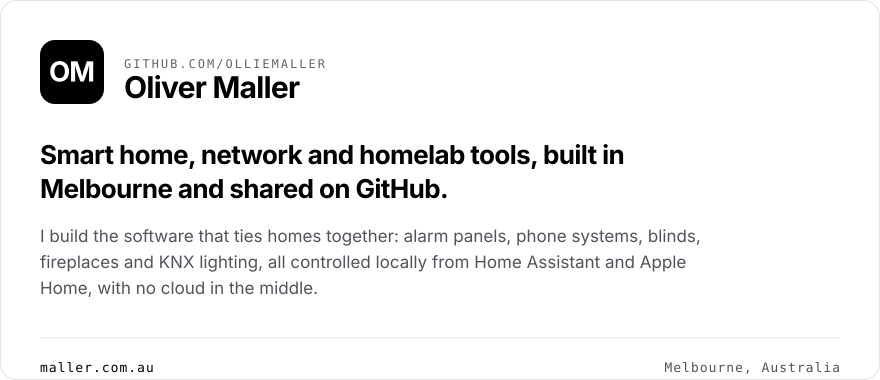
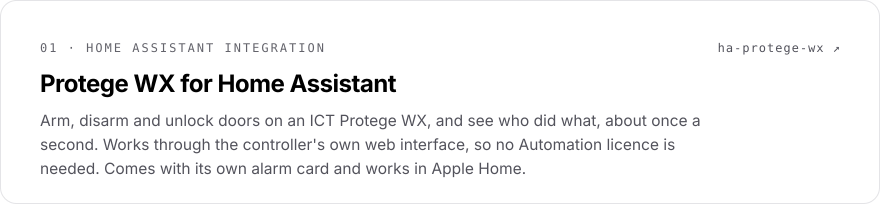
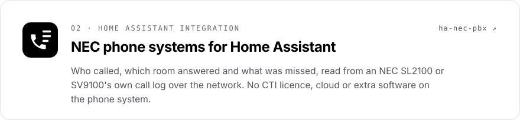
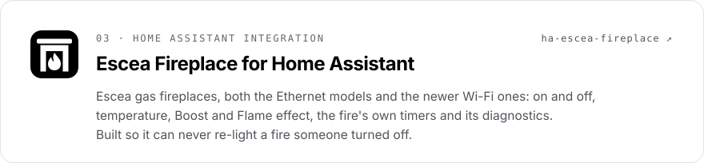
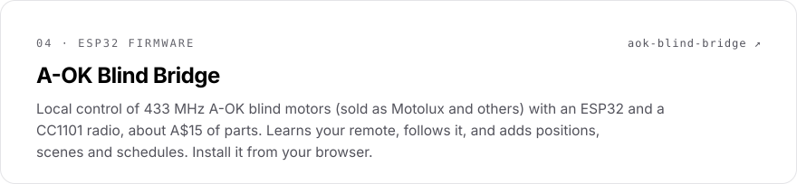
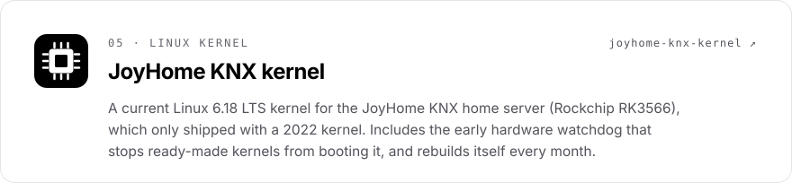
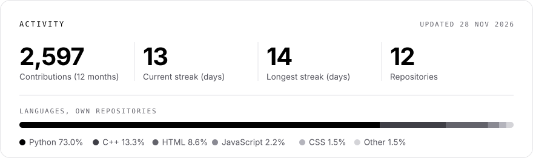

<a href="https://maller.com.au">
  <picture>
    <source media="(prefers-color-scheme: dark)" srcset="assets/hero-dark.svg">
    
  </picture>
</a>

  <a href="https://maller.com.au"><b>maller.com.au</b></a> ·
  <a href="mailto:oliver@maller.com.au">oliver@maller.com.au</a>

 

<a href="https://maller.com.au/#projects">
  <picture>
    <source media="(prefers-color-scheme: dark)" srcset="assets/projects-dark.svg">
    
  </picture>
</a>

<a href="https://github.com/olliemaller/ha-protege-wx">
  <picture>
    <source media="(prefers-color-scheme: dark)" srcset="assets/project-ha-protege-wx-dark.svg">
    
  </picture>
</a>

  <a href="https://github.com/olliemaller/ha-protege-wx"><b>Repository</b></a> ·
  <a href="https://my.home-assistant.io/redirect/hacs_repository/?owner=olliemaller&repository=ha-protege-wx&category=integration">Open in HACS</a>

<a href="https://github.com/olliemaller/ha-nec-pbx">
  <picture>
    <source media="(prefers-color-scheme: dark)" srcset="assets/project-ha-nec-pbx-dark.svg">
    
  </picture>
</a>

  <a href="https://github.com/olliemaller/ha-nec-pbx"><b>Repository</b></a> ·
  <a href="https://my.home-assistant.io/redirect/hacs_repository/?owner=olliemaller&repository=ha-nec-pbx&category=integration">Open in HACS</a>

<a href="https://github.com/olliemaller/ha-escea-fireplace">
  <picture>
    <source media="(prefers-color-scheme: dark)" srcset="assets/project-ha-escea-fireplace-dark.svg">
    
  </picture>
</a>

  <a href="https://github.com/olliemaller/ha-escea-fireplace"><b>Repository</b></a> ·
  <a href="https://my.home-assistant.io/redirect/hacs_repository/?owner=olliemaller&repository=ha-escea-fireplace&category=integration">Open in HACS</a> ·
  <a href="https://github.com/olliemaller/aioescea">aioescea library</a>

<a href="https://github.com/olliemaller/aok-blind-bridge">
  <picture>
    <source media="(prefers-color-scheme: dark)" srcset="assets/project-aok-blind-bridge-dark.svg">
    
  </picture>
</a>

  <a href="https://github.com/olliemaller/aok-blind-bridge"><b>Repository</b></a> ·
  <a href="https://blinds.maller.com.au/">Install from your browser</a>

<a href="https://github.com/olliemaller/joyhome-knx-kernel">
  <picture>
    <source media="(prefers-color-scheme: dark)" srcset="assets/project-joyhome-knx-kernel-dark.svg">
    
  </picture>
</a>

  <a href="https://github.com/olliemaller/joyhome-knx-kernel"><b>Repository</b></a>

 

<picture>
  <source media="(prefers-color-scheme: dark)" srcset="https://raw.githubusercontent.com/olliemaller/olliemaller/output/stats-dark.svg">
  
</picture>

  <picture>
    <source media="(prefers-color-scheme: dark)" srcset="https://raw.githubusercontent.com/olliemaller/olliemaller/output/snake-dark.svg">
    <source media="(prefers-color-scheme: light)" srcset="https://raw.githubusercontent.com/olliemaller/olliemaller/output/snake-light.svg">
    
  </picture>

<picture>
  <source media="(prefers-color-scheme: dark)" srcset="https://raw.githubusercontent.com/olliemaller/olliemaller/output/fun-dark.svg">
  
</picture>

  Upstream fixes, the rest of my projects and how to reach me: <a href="https://maller.com.au">maller.com.au</a>

