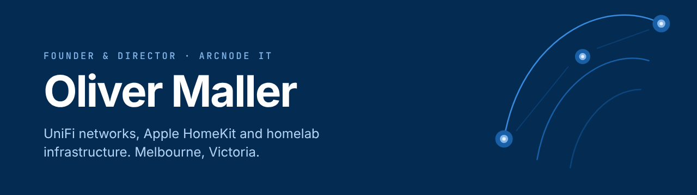

  

  
  
  

---

## About me

I run **[Arcnode IT](https://arcnode.com.au)** in Melbourne. We design, install and support UniFi networks, security and Apple HomeKit automation for homes and small businesses. Outside work I'm in my homelab, testing new gear and writing integrations for hardware that doesn't have one yet.

<table>
  <tr>
    <td width="33%" valign="top">
      <h3>Networks</h3>
      UniFi Network, Protect, Access and Intercom. Surveyed, installed, labelled and documented.
    </td>
    <td width="33%" valign="top">
      <h3>Smart homes</h3>
      Apple HomeKit and Home Assistant: alarms, locks, cameras and climate, in one app the whole household can use.
    </td>
    <td width="33%" valign="top">
      <h3>Homelab</h3>
      Proxmox, Docker and Kubernetes. Everything gets tried here before it goes near a client site.
    </td>
  </tr>
</table>

## Featured project

<table>
  <tr>
    <td width="96" valign="top">
      
    </td>
    <td valign="top">
      <a href="https://github.com/olliemaller/ha-protege-wx"><b>ha-protege-wx</b></a>: a Home Assistant integration for <b>ICT Protege WX</b> alarm and access controllers.
      Arm, disarm, unlock doors and see who did what, about once a second, through the controller's own web interface. No Automation licence needed, and it works with Apple Home through the HomeKit Bridge.
        
      
      
      
    </td>
  </tr>
</table>

**Also working on:** [homebridge-daikin-airbase](https://github.com/olliemaller/homebridge-daikin-airbase) (Daikin Airbase in HomeKit) · [ProxmoxVE](https://github.com/olliemaller/ProxmoxVE) (community helper scripts)

## Toolbox

**Networks and smart home**

  
  
  
  
  

**Homelab and infrastructure**

  
  
  
  
  
  
  
  

**Code and everyday**

  
  
  
  
  
  
  

## Stats

  
  

  

  <picture>
    <source media="(prefers-color-scheme: dark)" srcset="https://raw.githubusercontent.com/olliemaller/olliemaller/output/snake-dark.svg">
    <source media="(prefers-color-scheme: light)" srcset="https://raw.githubusercontent.com/olliemaller/olliemaller/output/snake-light.svg">
    
  </picture>

## Just for fun

  

  

---

  <b>A full network overhaul, or HomeKit in a single room?</b> 
  <a href="https://arcnode.com.au">Get in touch through Arcnode IT</a>, or open an issue on any of my repos.

